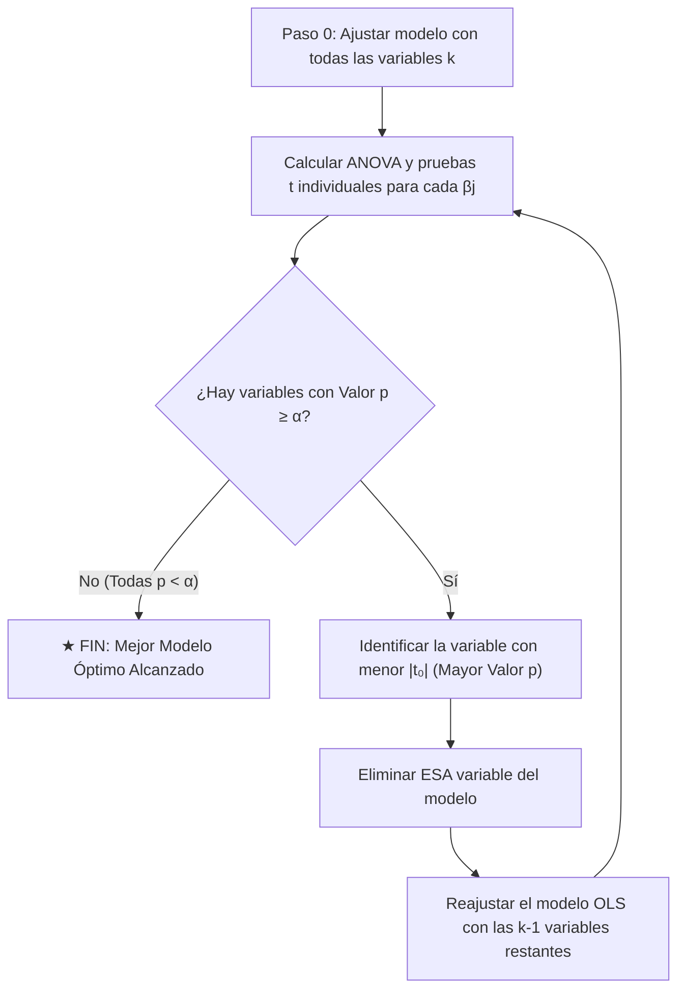

# Guía de Estudio y Manual Teórico-Práctico: Regresión Lineal Múltiple

**Cátedra:** Estadística Inferencial  
**Nivel Académico:** 7mo Semestre — Licenciatura en Computación  
**Facultad Experimental de Ciencias y Tecnología (FaCyT), Universidad de Carabobo**  
**Autor:** Antigravity (Advanced Agentic AI — Google DeepMind)  
**Fecha:** 8 de noviembre de 2026  

---

## Índice Temático
1. [Fundamentos y Formulación Matricial del Modelo](#1-fundamentos-y-formulación-matricial-del-modelo)
2. [Estimación por Mínimos Cuadrados Ordinarios (MCO)](#2-estimación-por-mínimos-cuadrados-ordinarios-mco)
3. [Propiedades Estadísticas de los Estimadores](#3-propiedades-estadísticas-de-los-estimadores)
4. [Estimación de la Varianza Residual ($\sigma^2$)](#4-estimación-de-la-varianza-residual-sigma2)
5. [Análisis de Varianza (ANOVA) y Bondad de Ajuste ($R^2$ vs. $R^2_{\text{adj}}$)](#5-análisis-de-varianza-anova-y-bondad-de-ajuste)
6. [Metodología de los 8 Pasos (Prof. Agustín) — Prueba $F$ Global](#6-metodología-de-los-8-pasos-prueba-f-global)
7. [Metodología de los 8 Pasos (Prof. Agustín) — Prueba $t$-Student Individual](#7-metodología-de-los-8-pasos-prueba-t-student-individual)
8. [Intervalos de Confianza y su Conexión con la Prueba de Hipótesis](#8-intervalos-de-confianza-y-su-conexión-con-la-prueba-de-hipótesis)
9. [Multicolinealidad y Factor de Inflación de la Varianza (VIF)](#9-multicolinealidad-y-factor-de-inflación-de-la-varianza-vif)
10. [Selección de Variables: Algoritmo de Eliminación Hacia Atrás (*Backward Elimination*)](#10-selección-de-variables-eliminación-hacia-atrás)
11. [Diagnóstico de Residuos y Supuestos del Modelo](#11-diagnóstico-de-residuos-y-supuestos-del-modelo)
12. [Inferencia para Nuevas Observaciones: Media Condicional vs. Predicción Individual](#12-inferencia-para-nuevas-observaciones)
13. [Formulario Resumen ("Chuleta" de Fórmulas Clave)](#13-formulario-resumen)
14. [Banco de Preguntas Típicas de Examen / Parcial (con Respuestas Argumentadas)](#14-banco-de-preguntas-típicas-de-examen)

---

## 1. Fundamentos y Formulación Matricial del Modelo

### 1.1 Definición Conceptual
La **Regresión Lineal Múltiple (RLM)** extiende la regresión lineal simple al escenario donde una variable continua de respuesta cuantitativa $y$ depende linealmente de un conjunto de $k$ variables explicativas o regresoras ($x_1, x_2, \dots, x_k$), más un término de perturbación aleatoria $\varepsilon$.

Para la $i$-ésima observación ($i = 1, 2, \dots, n$):
$$y_i = \beta_0 + \beta_1 x_{i1} + \beta_2 x_{i2} + \dots + \beta_k x_{ik} + \varepsilon_i$$

Donde:
* $\beta_0$: Intercepto o término constante (valor esperado de $y$ cuando todos los $x_j = 0$).
* $\beta_j$: Coeficiente parcial de regresión ($j = 1, \dots, k$). Representa el cambio esperado en la variable respuesta $y$ por unidad de incremento en $x_j$, **manteniendo constantes todas las demás variables regresoras** (*ceteris paribus*).
* $\varepsilon_i$: Error aleatorio no observable.

### 1.2 Estructura Matricial Compacta
El sistema de $n$ ecuaciones lineales se expresa de forma compacta como:
$$\mathbf{y} = \mathbf{X}\boldsymbol{\beta} + \boldsymbol{\varepsilon}$$

Donde las dimensiones y significados son:
$$\mathbf{y} = \begin{bmatrix} y_1 \\ y_2 \\ \vdots \\ y_n \end{bmatrix}_{(n \times 1)}, \quad
\mathbf{X} = \begin{bmatrix} 
1 & x_{11} & x_{12} & \dots & x_{1k} \\
1 & x_{21} & x_{22} & \dots & x_{2k} \\
\vdots & \vdots & \vdots & \ddots & \vdots \\
1 & x_{n1} & x_{n2} & \dots & x_{nk}
\end{bmatrix}_{(n \times p)}, \quad
\boldsymbol{\beta} = \begin{bmatrix} \beta_0 \\ \beta_1 \\ \vdots \\ \beta_k \end{bmatrix}_{(p \times 1)}, \quad
\boldsymbol{\varepsilon} = \begin{bmatrix} \varepsilon_1 \\ \varepsilon_2 \\ \vdots \\ \varepsilon_n \end{bmatrix}_{(n \times 1)}$$

> [!NOTE]
> El número total de parámetros del modelo es $p = k + 1$ (los $k$ coeficientes de las pendientes más el intercepto $\beta_0$).  
> La matriz de diseño $\mathbf{X}$ tiene $n$ filas y $p$ columnas. La primera columna está formada enteramente por unos ($1$), correspondiente a la presencia del intercepto.

---

## 2. Estimación por Mínimos Cuadrados Ordinarios (MCO)

### 2.1 Deducción Matemática del Estimador $\hat{\boldsymbol{\beta}}$
El criterio de Mínimos Cuadrados Ordinarios consiste en hallar el vector de coeficientes estimados $\hat{\boldsymbol{\beta}}$ que minimice la **Suma de Cuadrados de los Errores** ($SS_E$ o $S(\boldsymbol{\beta})$):

$$S(\boldsymbol{\beta}) = \sum_{i=1}^n \varepsilon_i^2 = \boldsymbol{\varepsilon}'\boldsymbol{\varepsilon} = (\mathbf{y} - \mathbf{X}\boldsymbol{\beta})'(\mathbf{y} - \mathbf{X}\boldsymbol{\beta})$$

Expandiendo el producto matricial transpuesto:
$$S(\boldsymbol{\beta}) = \mathbf{y}'\mathbf{y} - \boldsymbol{\beta}'\mathbf{X}'\mathbf{y} - \mathbf{y}'\mathbf{X}\boldsymbol{\beta} + \boldsymbol{\beta}'\mathbf{X}'\mathbf{X}\boldsymbol{\beta}$$

Dado que $\boldsymbol{\beta}'\mathbf{X}'\mathbf{y}$ es un escalar (dimensión $1 \times 1$), es idéntico a su transpuesta $(\boldsymbol{\beta}'\mathbf{X}'\mathbf{y})' = \mathbf{y}'\mathbf{X}\boldsymbol{\beta}$. Por tanto:
$$S(\boldsymbol{\beta}) = \mathbf{y}'\mathbf{y} - 2\boldsymbol{\beta}'\mathbf{X}'\mathbf{y} + \boldsymbol{\beta}'\mathbf{X}'\mathbf{X}\boldsymbol{\beta}$$

Para minimizar la función, derivamos con respecto al vector $\boldsymbol{\beta}$ e igualamos al vector nulo $\mathbf{0}$:
$$\frac{\partial S(\boldsymbol{\beta})}{\partial \boldsymbol{\beta}} = -2\mathbf{X}'\mathbf{y} + 2\mathbf{X}'\mathbf{X}\boldsymbol{\beta} = \mathbf{0}$$

Dividiendo entre 2 y reordenando, obtenemos el **Sistema de Ecuaciones Normales de MCO**:
$$(\mathbf{X}'\mathbf{X})\hat{\boldsymbol{\beta}} = \mathbf{X}'\mathbf{y}$$

Si las columnas de $\mathbf{X}$ son linealmente independientes (no hay multicolinealidad exacta), la matriz $(\mathbf{X}'\mathbf{X})$ es cuadrada de orden $p \times p$, simétrica y no singular (su determinante es distinto de cero). Multiplicando a la izquierda por su inversa $\mathbf{C} = (\mathbf{X}'\mathbf{X})^{-1}$:

$$\hat{\boldsymbol{\beta}} = (\mathbf{X}'\mathbf{X})^{-1} \mathbf{X}'\mathbf{y} = \mathbf{C} \, \mathbf{X}'\mathbf{y}$$

---

## 3. Propiedades Estadísticas de los Estimadores

### 3.1 Supuestos Clásicos de Gauss-Markov
1. **Linealidad:** La relación entre la media de $y$ y los regresores es lineal en los parámetros: $E[\mathbf{y}] = \mathbf{X}\boldsymbol{\beta}$.
2. **Esperanza nula de los errores:** $E[\boldsymbol{\varepsilon}] = \mathbf{0}$.
3. **Homocedasticidad y no autocorrelación (Esfericidad del error):**
   $$\operatorname{Cov}(\boldsymbol{\varepsilon}) = E[\boldsymbol{\varepsilon}\boldsymbol{\varepsilon}'] = \sigma^2 \mathbf{I}_n = \begin{bmatrix} 
   \sigma^2 & 0 & \dots & 0 \\
   0 & \sigma^2 & \dots & 0 \\
   \vdots & \vdots & \ddots & \vdots \\
   0 & 0 & \dots & \sigma^2
   \end{bmatrix}$$
   Los errores tienen varianza constante $\sigma^2$ y covarianza cero entre observaciones distintas ($\operatorname{Cov}(\varepsilon_i, \varepsilon_j) = 0$ para $i \neq j$).
4. **Matriz $\mathbf{X}$ no estocástica:** Los valores de los regresores son fijos en muestreo repetido y la matriz tiene rango completo ($\operatorname{rango}(\mathbf{X}) = p < n$).
5. **Normalidad (para Inferencia):** $\boldsymbol{\varepsilon} \sim N(\mathbf{0}, \sigma^2 \mathbf{I}_n)$.

### 3.2 Insesgadez de $\hat{\boldsymbol{\beta}}$
Demostración de que el valor esperado del estimador coincide con el parámetro poblacional:
$$\hat{\boldsymbol{\beta}} = (\mathbf{X}'\mathbf{X})^{-1}\mathbf{X}'\mathbf{y} = (\mathbf{X}'\mathbf{X})^{-1}\mathbf{X}'(\mathbf{X}\boldsymbol{\beta} + \boldsymbol{\varepsilon}) = \boldsymbol{\beta} + (\mathbf{X}'\mathbf{X})^{-1}\mathbf{X}'\boldsymbol{\varepsilon}$$
$$E[\hat{\boldsymbol{\beta}}] = \boldsymbol{\beta} + (\mathbf{X}'\mathbf{X})^{-1}\mathbf{X}' E[\boldsymbol{\varepsilon}] = \boldsymbol{\beta} + \mathbf{0} = \boldsymbol{\beta}$$

### 3.3 Matriz de Varianzas y Covarianzas de $\hat{\boldsymbol{\beta}}$
$$\operatorname{Cov}(\hat{\boldsymbol{\beta}}) = \operatorname{Cov}\left((\mathbf{X}'\mathbf{X})^{-1}\mathbf{X}'\mathbf{y}\right) = (\mathbf{X}'\mathbf{X})^{-1}\mathbf{X}' \left[ \operatorname{Cov}(\mathbf{y}) \right] \mathbf{X} (\mathbf{X}'\mathbf{X})^{-1}$$
Dado que $\operatorname{Cov}(\mathbf{y}) = \sigma^2 \mathbf{I}_n$:
$$\operatorname{Cov}(\hat{\boldsymbol{\beta}}) = \sigma^2 (\mathbf{X}'\mathbf{X})^{-1}\mathbf{X}'\mathbf{X}(\mathbf{X}'\mathbf{X})^{-1} = \sigma^2 (\mathbf{X}'\mathbf{X})^{-1} = \sigma^2 \mathbf{C}$$

> [!IMPORTANT]
> Los elementos diagonales de la matriz $\mathbf{C} = (\mathbf{X}'\mathbf{X})^{-1}$, denotados como $C_{jj}$, escalan directamente la varianza de cada estimador individual:
> $$\operatorname{Var}(\hat{\beta}_j) = \sigma^2 C_{jj}$$
> Mientras que los elementos fuera de la diagonal representan las covarianzas entre coeficientes:
> $$\operatorname{Cov}(\hat{\beta}_j, \hat{\beta}_i) = \sigma^2 C_{ji}$$

---

## 4. Estimación de la Varianza Residual ($\sigma^2$)

La varianza del error $\sigma^2$ es desconocida y debe estimarse a partir de los datos muestrales. El estimador insesgado de $\sigma^2$ es el **Cuadrado Medio del Error ($MS_E$)**:

$$\hat{\sigma}^2 = MS_E = \frac{SS_E}{n - p}$$

Donde:
* **Suma de Cuadrados del Error ($SS_E$):**
  $$SS_E = \sum_{i=1}^n e_i^2 = \sum_{i=1}^n (y_i - \hat{y}_i)^2$$
  O en forma matricial analítica:
  $$SS_E = \mathbf{y}'\mathbf{y} - \hat{\boldsymbol{\beta}}'\mathbf{X}'\mathbf{y}$$
* **Grados de libertad residuales:** $gl_E = n - p = n - (k + 1)$. Se restan $p$ grados de libertad porque se estimaron $p$ parámetros desconocidos $(\beta_0, \beta_1, \dots, \beta_k)$.
* **Error Estándar de la Regresión:**
  $$\hat{\sigma} = \sqrt{MS_E}$$
  Mide la dispersión típica de los puntos observados alrededor del hiperplano de regresión ajustado, en las mismas unidades de medida de la variable respuesta $y$.

---

## 5. Análisis de Varianza (ANOVA) y Bondad de Ajuste

### 5.1 Descomposición de la Variabilidad Total
La variabilidad total observada en la variable respuesta alrededor de su media muestral $\bar{y}$ se particiona en dos componentes ortogonales:
$$\sum_{i=1}^n (y_i - \bar{y})^2 = \sum_{i=1}^n (\hat{y}_i - \bar{y})^2 + \sum_{i=1}^n (y_i - \hat{y}_i)^2$$
$$SS_T = SS_R + SS_E$$

* **$SS_T$ ($S_{yy}$):** Suma Total de Cuadrados (Variabilidad total observada).
  $$SS_T = \sum_{i=1}^n y_i^2 - \frac{(\sum y_i)^2}{n} = \mathbf{y}'\mathbf{y} - n\bar{y}^2 \quad (gl_T = n - 1)$$
* **$SS_R$:** Suma de Cuadrados de la Regresión (Variabilidad explicada por el modelo).
  $$SS_R = \hat{\boldsymbol{\beta}}'\mathbf{X}'\mathbf{y} - n\bar{y}^2 \quad (gl_R = k)$$
* **$SS_E$:** Suma de Cuadrados del Error (Variabilidad no explicada o residual).
  $$SS_E = SS_T - SS_R \quad (gl_E = n - p = n - k - 1)$$

### 5.2 Estructura de la Tabla ANOVA para RLM

| Fuente de Variación (FV) | Suma de Cuadrados (SC) | Grados de Libertad ($gl$) | Cuadrado Medio ($CM = SC / gl$) | Estadístico de Prueba $F_0$ | Valor $p$ |
| :--- | :---: | :---: | :---: | :---: | :---: |
| **Regresión (Modelo)** | $SS_R$ | $k$ | $MS_R = \frac{SS_R}{k}$ | $F_0 = \frac{MS_R}{MS_E}$ | $P(F_{k, n-p} \ge F_0)$ |
| **Error (Residual)** | $SS_E$ | $n - p$ | $MS_E = \frac{SS_E}{n - p}$ | — | — |
| **Total Corregido** | $SS_T$ | $n - 1$ | — | — | — |

### 5.3 Coeficiente de Determinación ($R^2$) y Coeficiente Ajustado ($R^2_{\text{adj}}$)
* **$R^2$ Ordinario:** Proporción de la variabilidad total de $y$ explicada por el conjunto de regresores:
  $$R^2 = \frac{SS_R}{SS_T} = 1 - \frac{SS_E}{SS_T}, \quad 0 \le R^2 \le 1$$
  > [!WARNING]
  > El $R^2$ ordinario **nunca disminuye** cuando se agrega un nuevo regresor al modelo, incluso si dicha variable es completamente irrelevante o mero ruido blanco. Esto se debe a que $(\mathbf{y} - \mathbf{X}\boldsymbol{\beta})'(\mathbf{y} - \mathbf{X}\boldsymbol{\beta})$ se minimiza en un espacio vectorial de mayor dimensión. Por ello, usar $R^2$ para comparar modelos con distinto número de variables induce a un sesgo artificial hacia modelos sobreajustados.

* **$R^2$ Ajustado ($R^2_{\text{adj}}$):** Penaliza la inclusión de variables innecesarias dividiendo cada suma de cuadrados por sus respectivos grados de libertad:
  $$R^2_{\text{adj}} = 1 - \frac{SS_E / (n - p)}{SS_T / (n - 1)} = 1 - \left( \frac{n - 1}{n - p} \right)(1 - R^2)$$
  $R^2_{\text{adj}}$ **solo aumentará si la nueva variable agregada reduce $MS_E$**, lo cual ocurre matemáticamente si y solo si el estadístico individual de la nueva variable cumple $|t_0| > 1$.

---

## 6. Metodología de los 8 Pasos (Prof. Agustín) — Prueba $F$ Global

La prueba de significancia global evalúa si existe al menos una variable regresora en el modelo que aporte información lineal relevante para predecir la variable dependiente $y$.

```
   ┌────────────────────────────────────────────────────────┐
   │         ESTRUCTURA DE LOS 8 PASOS DE LA CÁTEDRA        │
   ├────────────────────────┬───────────────────────────────┤
   │ 1. Contextualización   │ 5. Estadístico de prueba      │
   │ 2. Hipótesis Nula H₀   │ 6. Región Crítica / Regla     │
   │ 3. Hipótesis Alt. H₁   │ 7. Cálculo y sustitución      │
   │ 4. Nivel α             │ 8. Decisión y conclusión      │
   └────────────────────────┴───────────────────────────────┘
```

1. **Contextualización:** Determinar si existe relación lineal estadísticamente significativa entre la variable dependiente $y$ y el conjunto de $k$ variables regresoras $(x_1, x_2, \dots, x_k)$.
2. **Hipótesis Nula ($H_0$):**
   $$H_0: \beta_1 = \beta_2 = \dots = \beta_k = 0$$
   *(Ninguna variable regresora aporta información explicativa; el modelo no es válido).* 
3. **Hipótesis Alternativa ($H_1$):**
   $$H_1: \beta_j \neq 0 \quad \text{para al menos un } j \in \{1, 2, \dots, k\}$$
   *(Al menos una de las variables explicativas influye significativamente en $y$).* 
4. **Nivel de Significancia:** $\alpha$ (comúnmente $\alpha = 0.05$ o $\alpha = 0.01$).
5. **Estadístico de Prueba:**
   $$F_0 = \frac{MS_R}{MS_E} = \frac{SS_R / k}{SS_E / (n - p)} \sim F_{(k, \; n-p)}$$
   Bajo $H_0$, este estadístico sigue una distribución $F$ de Fisher-Snedecor con $k$ grados de libertad en el numerador y $n - p$ grados de libertad en el denominador.
6. **Regla de Decisión:**
   * **Por Región Crítica:** Se rechaza $H_0$ si:
     $$F_0 > F_{\alpha; \; k, \; n-p}$$
   * **Por Valor $p$:** Se rechaza $H_0$ si:
     $$\text{Valor } p = P(F_{k, \; n-p} \ge F_0) < \alpha$$
7. **Cálculos y Sustitución Numérica:**
   Presentar explícitamente $SS_R, SS_E, MS_R, MS_E$, el valor numérico obtenido para $F_0$, el valor crítico de la tabla $F$ y el valor $p$.
8. **Decisión y Conclusión en el Contexto:**
   * Si $F_0 > F_{\text{crítico}}$ (Valor $p < \alpha$): **Se rechaza $H_0$**. Con un nivel de confianza del $(1 - \alpha) \cdot 100\%$, existe evidencia estadística suficiente para afirmar que el modelo de regresión lineal múltiple es significativo (al menos una variable aporta información).
   * Si $F_0 \le F_{\text{crítico}}$ (Valor $p \ge \alpha$): **No se rechaza $H_0$**. El modelo global no es significativo.

---

## 7. Metodología de los 8 Pasos (Prof. Agustín) — Prueba $t$-Student Individual

Una vez comprobado que el modelo global es significativo, es imperativo evaluar la **contribución marginal o parcial de cada coeficiente $\beta_j$ en presencia de todas las demás variables regresoras**.

1. **Parámetro de Interés:** El coeficiente parcial de regresión $\beta_j$ correspondiente al regresor $x_j$ en presencia de las restantes variables del modelo.
2. **Hipótesis Nula ($H_0$):**
   $$H_0: \beta_j = 0$$
   *(La variable $x_j$ no aporta información lineal significativa a la predicción de $y$ una vez consideradas las otras variables regresoras).* 
3. **Hipótesis Alternativa ($H_1$):**
   $$H_1: \beta_j \neq 0$$
   *(La variable $x_j$ sí aporta significativamente al modelo; prueba bilateral).* 
4. **Nivel de Significancia:** $\alpha$ (en una prueba bilateral, el área en cada cola de la distribución es $\alpha / 2$).
5. **Estadístico de Prueba:**
   $$T_0 = \frac{\hat{\beta}_j - 0}{SE(\hat{\beta}_j)} = \frac{\hat{\beta}_j}{\sqrt{\hat{\sigma}^2 C_{jj}}} \sim t_{(n - p)}$$
   Donde $C_{jj}$ es el $j$-ésimo elemento diagonal de la matriz inversa $\mathbf{C} = (\mathbf{X}'\mathbf{X})^{-1}$, y $\hat{\sigma}^2 = MS_E$.
6. **Regla de Decisión (Región Crítica Bilateral):**
   * Se rechaza $H_0$ si:
     $$|T_0| > t_{\alpha/2, \; n-p}$$
     Es decir, si $T_0 < -t_{\alpha/2, \; n-p}$ o si $T_0 > +t_{\alpha/2, \; n-p}$.
   * Equivalentemente por valor $p$: Se rechaza $H_0$ si $\text{Valor } p = 2 \cdot P(t_{n-p} \ge |T_0|) < \alpha$.
7. **Cálculos Paso a Paso con Sustitución Numérica:**
   $$\text{Estimado puntual: } \hat{\beta}_j$$
   $$\text{Varianza residual: } \hat{\sigma}^2 = MS_E$$
   $$\text{Elemento diagonal inverso: } C_{jj}$$
   $$SE(\hat{\beta}_j) = \sqrt{\hat{\sigma}^2 \cdot C_{jj}}$$
   $$T_0 = \frac{\hat{\beta}_j}{SE(\hat{\beta}_j)}$$
8. **Decisión y Acción:**
   * Si $|T_0| > t_{\text{crítico}}$ (Valor $p < \alpha$): **Se rechaza $H_0$**. La variable $x_j$ **sí contribuye significativamente** al modelo y debe mantenerse.
   * Si $|T_0| \le t_{\text{crítico}}$ (Valor $p \ge \alpha$): **No se rechaza $H_0$**. La variable $x_j$ **no contribuye significativamente** en presencia de las demás y es candidata a ser eliminada en la siguiente iteración de mejora del modelo.

---

## 8. Intervalos de Confianza y su Conexión con la Prueba de Hipótesis

Un Intervalo de Confianza al $(1 - \alpha) \cdot 100\%$ para el coeficiente de regresión $\beta_j$ está dado por:

$$IC_{1-\alpha}(\beta_j): \hat{\beta}_j \pm t_{\alpha/2, \; n-p} \cdot SE(\hat{\beta}_j) = \left[ \hat{\beta}_j - t_{\alpha/2, \; n-p} \sqrt{\hat{\sigma}^2 C_{jj}} \; ; \; \hat{\beta}_j + t_{\alpha/2, \; n-p} \sqrt{\hat{\sigma}^2 C_{jj}} \right]$$

### Teorema de Equivalencia Matemática
Existe una relación unívoca entre la prueba de hipótesis bilateral y el intervalo de confianza:
$$\text{No Rechazar } H_0: \beta_j = 0 \iff 0 \in IC_{1-\alpha}(\beta_j) \iff |T_0| \le t_{\alpha/2, \; n-p} \iff \text{Valor } p \ge \alpha$$

* Si el intervalo de confianza **contiene al número cero** (el límite inferior es negativo y el superior es positivo), significa que el cero es un valor plausible para el verdadero parámetro $\beta_j$. Por consiguiente, la variable no es significativa.
* Si el intervalo de confianza **no contiene al cero** (ambos límites son estrictamente positivos o ambos son estrictamente negativos), se rechaza con total certeza $H_0: \beta_j = 0$.

---

## 9. Multicolinealidad y Factor de Inflación de la Varianza (VIF)

### 9.1 ¿Qué es la Multicolinealidad?
Ocurre cuando existe una correlación lineal moderada o fuerte entre dos o más variables regresoras ($x_j$ y $x_m$). 

**Consecuencias de la multicolinealidad:**
1. Los estimadores $\hat{\beta}_j$ continúan siendo insesgados, pero sus varianzas $\operatorname{Var}(\hat{\beta}_j) = \sigma^2 C_{jj}$ se **inflan drásticamente** (se hacen gigantescas).
2. Los errores estándar $SE(\hat{\beta}_j)$ aumentan, haciendo que los estadísticos $T_0 = \hat{\beta}_j / SE(\hat{\beta}_j)$ caigan cerca de cero.
3. Se produce la **paradoja de la regresión**: La prueba $F$ global rechaza contundentemente $H_0$ ($F_0$ gigantesco, modelo muy significativo), pero ninguna o casi ninguna de las pruebas individuales $t$ logra rechazar su $H_0$ individual.

### 9.2 Factor de Inflación de la Varianza (VIF)
Para cuantificar el grado en que la varianza de $\hat{\beta}_j$ está inflada por la colinealidad con los otros regresores, se define el $VIF_j$:
$$VIF_j = \frac{1}{1 - R_j^2}$$
Donde $R_j^2$ es el coeficiente de determinación que resulta de hacer una regresión auxiliar de la variable $x_j$ en función de todas las demás variables regresoras restantes.

* **$VIF_j = 1$:** Ausencia total de correlación lineal con los demás regresores.
* **$1 < VIF_j < 5$:** Colinealidad baja a moderada (segura y manejable).
* **$5 \le VIF_j < 10$:** Colinealidad alta (debe prestarse atención a signos o inestabilidad).
* **$VIF_j \ge 10$:** Multicolinealidad severa (indica que más del 90% de la información de $x_j$ es redundante y ya está explicada por las otras variables).

---

## 10. Selección de Variables: Eliminación Hacia Atrás (*Backward Elimination*)

El objetivo de la selección de variables es encontrar el **modelo parsimonioso óptimo**: aquel que logre el mayor poder explicativo posible ($R^2_{\text{adj}}$ máximo y $MS_E$ mínimo) con el menor número necesario de variables, evitando sobreajuste y redundancia.



### Reglas Fundamentales del Algoritmo
1. **Eliminar solo UNA variable por iteración:** Nunca se eliminan múltiples variables a la vez. Al retirar una variable, la matriz $\mathbf{X}'\mathbf{X}$ y su inversa $\mathbf{C}$ se recalculan completamente, redistribuyendo la varianza compartida entre los regresores que quedan. Variables que antes parecían no significativas frecuentemente se vuelven altamente significativas en el siguiente paso.
2. **Criterio de Selección de Salida:** Se elimina la variable que tenga el estadístico individual más cercano a cero (el menor $|t_0|$, o equivalentemente el mayor valor $p$), siempre que dicho valor $p \ge \alpha$.
3. **Criterio de Parada:** El algoritmo se detiene cuando **todas** las variables regresoras presentes en el modelo satisfacen $|t_0| > t_{\text{crítico}}$ (Valor $p < \alpha$).

---

## 11. Diagnóstico de Residuos y Supuestos del Modelo

Los residuos muestrales ordinarios se definen como:
$$e_i = y_i - \hat{y}_i, \quad i = 1, \dots, n$$
Y los **residuos estandarizados**:
$$d_i = \frac{e_i}{\sqrt{MS_E}}$$

Los tres diagnósticos gráficos obligatorios son:

| Diagnóstico Gráfico | Eje Horizontal ($X$) | Eje Vertical ($Y$) | Supuesto que Valida | Patrón Esperado (Modelo Válido) |
| :--- | :---: | :---: | :---: | :--- |
| **Q-Q Plot Normal** | Cuantiles Teóricos Normales | Residuos Estandarizados ($d_i$) | **Normalidad** ($\varepsilon \sim N$) | Puntos alineados a lo largo de la recta diagonal de 45°. Puntos en forma de "S" indican colas pesadas o asimetría. |
| **Residuos vs. $\hat{y}$** | Valores Predichos ($\hat{y}_i$) | Residuos Ordinarios ($e_i$) | **Homocedasticidad y Linealidad** | Nube de puntos distribuida aleatoriamente dentro de una banda horizontal paralela a $e=0$. Formas de embudo indican heterocedasticidad. Formas de parábola indican no linealidad. |
| **Residuos vs. $x_j$** | Variable Regresora ($x_{ij}$) | Residuos Ordinarios ($e_i$) | **Relación Lineal de $x_j$** | Distribución uniforme alrededor de cero. Si se observa una curvatura, $x_j$ requiere una transformación (como $x_j^2$ o $\ln(x_j)$). |

---

## 12. Inferencia para Nuevas Observaciones

Sea $\mathbf{x}_0 = [1, x_{01}, x_{02}, \dots, x_{0k}]'$ un vector con los valores de las variables regresoras donde se desea evaluar el modelo.

### 12.1 Predicción Puntual y Apalancamiento (*Leverage*)
La estimación puntual es:
$$\hat{y}_0 = \mathbf{x}_0' \hat{\boldsymbol{\beta}}$$

El valor de **apalancamiento muestral ($h_0$)** mide la distancia cuadrática normalizada de $\mathbf{x}_0$ al centro de gravedad de la muestra:
$$h_0 = \mathbf{x}_0' (\mathbf{X}'\mathbf{X})^{-1} \mathbf{x}_0 = \mathbf{x}_0' \mathbf{C} \, \mathbf{x}_0$$

### 12.2 Los Dos Tipos de Intervalos de Inferencia

```
                        INTERVALOS DE ESTIMACIÓN EN x₀
                                       │
            ┌──────────────────────────┴──────────────────────────┐
            │                                                     │
[Intervalo para la Media E(y|x₀)]                     [Intervalo para un Individuo y₀]
Estima el promedio de toda la población               Predice el valor exacto de un sujeto nuevo
Varianza: Var(ŷ₀) = σ² · h₀                           Varianza: Var(y₀ - ŷ₀) = σ² · (1 + h₀)
Amplitud: Estrecha                                    Amplitud: Amplia (incluye la variabilidad σ²)
```

1. **Intervalo de Confianza para la Respuesta Media $E(y | \mathbf{x}_0)$:**
   $$IC_{1-\alpha}(E(y|\mathbf{x}_0)): \hat{y}_0 \pm t_{\alpha/2, \; n-p} \sqrt{\hat{\sigma}^2 \, h_0}$$
2. **Intervalo de Predicción para una Observación Futura Individual $y_0$:**
   $$IP_{1-\alpha}(y_0): \hat{y}_0 \pm t_{\alpha/2, \; n-p} \sqrt{\hat{\sigma}^2 \, (1 + h_0)}$$

> [!CAUTION]
> **Peligro de la Extrapolación:** El hiperplano ajustado solo es válido dentro del dominio de interpolación delimitado por la nube de puntos muestral. Intentar predecir fuera de los rangos $[\min(x_j), \max(x_j)]$ produce un $h_0$ muy elevado y una drástica pérdida de fiabilidad física en las predicciones.

---

## 13. Formulario Resumen ("Chuleta" de Fórmulas Clave)

| Concepto / Métrica | Fórmula Analítica |
| :--- | :--- |
| **Estimador MCO** | $\hat{\boldsymbol{\beta}} = (\mathbf{X}'\mathbf{X})^{-1}\mathbf{X}'\mathbf{y} = \mathbf{C} \, \mathbf{X}'\mathbf{y}$ |
| **Matriz de Covarianzas** | $\operatorname{Cov}(\hat{\boldsymbol{\beta}}) = \sigma^2 \mathbf{C} = \sigma^2 (\mathbf{X}'\mathbf{X})^{-1}$ |
| **Suma Total de Cuadrados** | $SS_T = S_{yy} = \sum y_i^2 - n\bar{y}^2 = \mathbf{y}'\mathbf{y} - n\bar{y}^2$ |
| **Suma de Cuadrados de Regresión** | $SS_R = \hat{\boldsymbol{\beta}}'\mathbf{X}'\mathbf{y} - n\bar{y}^2$ |
| **Suma de Cuadrados del Error** | $SS_E = \sum (y_i - \hat{y}_i)^2 = \mathbf{y}'\mathbf{y} - \hat{\boldsymbol{\beta}}'\mathbf{X}'\mathbf{y} = SS_T - SS_R$ |
| **Varianza Residual Insesgada** | $\hat{\sigma}^2 = MS_E = \frac{SS_E}{n - p}$ |
| **Estadístico $F_0$ Global** | $F_0 = \frac{MS_R}{MS_E} = \frac{SS_R / k}{SS_E / (n - p)}$ |
| **Coeficiente $R^2$** | $R^2 = \frac{SS_R}{SS_T} = 1 - \frac{SS_E}{SS_T}$ |
| **Coeficiente $R^2$ Ajustado** | $R^2_{\text{adj}} = 1 - \frac{MS_E}{MS_T} = 1 - \left(\frac{n-1}{n-p}\right)(1 - R^2)$ |
| **Error Estándar de $\hat{\beta}_j$** | $SE(\hat{\beta}_j) = \sqrt{\hat{\sigma}^2 C_{jj}} = \sqrt{MS_E \cdot C_{jj}}$ |
| **Estadístico $t_0$ Individual** | $T_0 = \frac{\hat{\beta}_j}{SE(\hat{\beta}_j)} = \frac{\hat{\beta}_j}{\sqrt{MS_E \cdot C_{jj}}}$ |
| **Intervalo de Confianza para $\beta_j$** | $\hat{\beta}_j \pm t_{\alpha/2, \; n-p} \cdot \sqrt{MS_E \cdot C_{jj}}$ |
| **VIF (Factor Inflación Varianza)** | $VIF_j = \frac{1}{1 - R_j^2}$ |
| **Apalancamiento de $\mathbf{x}_0$** | $h_0 = \mathbf{x}_0' \mathbf{C} \, \mathbf{x}_0$ |
| **IC para la Media $E(y|\mathbf{x}_0)$** | $\hat{y}_0 \pm t_{\alpha/2, \; n-p} \sqrt{MS_E \cdot h_0}$ |
| **IP para una Observación $y_0$** | $\hat{y}_0 \pm t_{\alpha/2, \; n-p} \sqrt{MS_E \cdot (1 + h_0)}$ |

---

## 14. Banco de Preguntas Típicas de Examen / Parcial

### Pregunta 1
**Enunciado:** En un modelo de RLM con $n = 35$ observaciones y $k = 4$ variables regresoras, el investigador obtiene $SS_T = 1200$ y $SS_E = 300$.
a) Calcule el valor del estadístico $F_0$ de significancia global.  
b) Con $\alpha = 0.05$ (donde $F_{0.05; \; 4, \; 30} = 2.69$), ¿cuál es la decisión estadística?

**Respuesta Argumentada:**
1. Datos: $n = 35, k = 4, p = k + 1 = 5, gl_E = n - p = 35 - 5 = 30, gl_R = k = 4$.
2. $SS_R = SS_T - SS_E = 1200 - 300 = 900$.
3. Cuadrados Medios:
   $$MS_R = \frac{SS_R}{k} = \frac{900}{4} = 225$$
   $$MS_E = \frac{SS_E}{n - p} = \frac{300}{30} = 10$$
4. Estadístico:
   $$F_0 = \frac{MS_R}{MS_E} = \frac{225}{10} = 22.5$$
5. Decisión: Como $F_0 = 22.5 > F_{0.05; \; 4, \; 30} = 2.69$, se rechaza contundentemente $H_0$. El modelo es altamente significativo con un 95% de confianza.

---

### Pregunta 2
**Enunciado:** Si el modelo del ejercicio anterior tiene $SS_T = 1200$ y $SS_E = 300$, calcule $R^2$ y $R^2_{\text{adj}}$. Explique por qué $R^2_{\text{adj}} < R^2$.

**Respuesta Argumentada:**
* $R^2 = 1 - \frac{SS_E}{SS_T} = 1 - \frac{300}{1200} = 1 - 0.25 = 0.75$ ($75.00\%$).
* $R^2_{\text{adj}} = 1 - \left( \frac{n - 1}{n - p} \right)(1 - R^2) = 1 - \left(\frac{34}{30}\right)(0.25) = 1 - (1.1333)(0.25) = 1 - 0.2833 = 0.7167$ ($71.67\%$).
* **Explicación:** $R^2_{\text{adj}}$ siempre es menor que $R^2$ porque introduce el factor de corrección $\frac{n - 1}{n - p} = \frac{34}{30} > 1$, penalizando la estimación por la cantidad de grados de libertad consumidos por los $p$ parámetros.

---

### Pregunta 3
**Enunciado:** Para un regresor $x_2$, se obtuvo un estimado $\hat{\beta}_2 = -4.50$. La varianza residual del modelo es $MS_E = 16$ y el elemento diagonal correspondiente en la matriz inversa es $C_{22} = 0.0625$. Los grados de libertad residuales son 20. Con $\alpha = 0.05$ ($t_{0.025, \; 20} = 2.086$):
a) Calcule el error estándar $SE(\hat{\beta}_2)$.  
b) Realice el contraste de hipótesis $H_0: \beta_2 = 0$ vs $H_1: \beta_2 \neq 0$.  
c) Construya el Intervalo de Confianza al 95% y verifique la decisión.

**Respuesta Argumentada:**
* a) $SE(\hat{\beta}_2) = \sqrt{MS_E \cdot C_{22}} = \sqrt{16 \times 0.0625} = \sqrt{1.0} = 1.00$.
* b) $T_0 = \frac{\hat{\beta}_2}{SE(\hat{\beta}_2)} = \frac{-4.50}{1.00} = -4.50$.  
  Como $|T_0| = 4.50 > 2.086$, **se rechaza $H_0: \beta_2 = 0$**. La variable $x_2$ contribuye significativamente al modelo.
* c) $IC_{0.95}(\beta_2) = -4.50 \pm (2.086)(1.00) = [-6.586 \; ; \; -2.414]$.  
  El intervalo no contiene al cero (ambos extremos son negativos), lo que confirma plenamente el rechazo de $H_0$.

---

### Pregunta 4
**Enunciado:** ¿Por qué en el método de Backward Elimination no se deben eliminar todas las variables con $p \ge \alpha$ simultáneamente?

**Respuesta Argumentada:**
Porque los coeficientes y sus errores estándar se calculan de manera condicional (parcial). Si dos variables regresoras comparten información (correlación entre ellas), sus estadísticos $t_0$ individuales pueden ser pequeños simultáneamente. Si se elimina solo la más débil, la varianza explicada compartida se transfiere a la otra variable, haciendo que su error estándar disminuya y su valor $p$ caiga por debajo de $\alpha$, volviéndose estadísticamente indispensable en el siguiente paso.

---

### Pregunta 5
**Enunciado:** Al evaluar un punto $\mathbf{x}_0$, ¿cuál intervalo es siempre más ancho: el de la respuesta media $E(y|\mathbf{x}_0)$ o el de una predicción individual $y_0$? Demuestre por qué analíticamente.

**Respuesta Argumentada:**
El intervalo de predicción individual es **estrictamente más ancho**.  
Analíticamente, la semiamplitud del intervalo medio es $t_{\text{crít}} \sqrt{MS_E \cdot h_0}$, mientras que la del individuo es $t_{\text{crít}} \sqrt{MS_E \cdot (1 + h_0)}$.  
Dado que $1 + h_0 > h_0$ para cualquier valor de apalancamiento, $\sqrt{1 + h_0} > \sqrt{h_0}$. La predicción individual debe absorber no solo la incertidumbre en la estimación de los parámetros de la recta/hiperplano ($\sigma^2 h_0$), sino también la variabilidad estocástica propia del individuo particular ($\sigma^2$).
